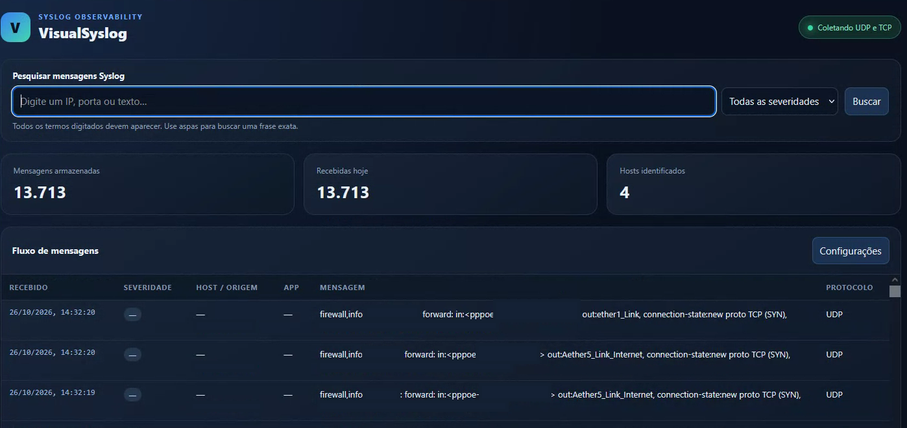

# VisualSyslog — Syslog Observability

**Versão estável / Current stable release: 2.6.0** · **Build de teste na branch / Branch test build: 2.6.1** · Licença / License: **GPL-2.0**

[Português (Brasil)](#português-brasil) | [English](#english) | [Baixar versão 2.6.0 / Download v2.6.0](https://github.com/cyberlinkrv/visualsyslog/releases/tag/v2.6.0)



---

## Português (Brasil)

O **VisualSyslog** recebe mensagens Syslog por UDP e TCP e as apresenta em um painel web local. Armazena os eventos em SQLite, permite pesquisar mensagens e configurar retenção e rede pela interface.

### Baixar a versão 2.6.0

| Sistema | Download | Instalação/uso |
|---|---|---|
| Windows — instalador recomendado | [VisualSyslog-Setup.exe](https://github.com/cyberlinkrv/visualsyslog/releases/download/v2.6.0/VisualSyslog-Setup.exe) | Execute o instalador e siga as instruções. |
| Windows — portátil | [VisualSyslog.exe](https://github.com/cyberlinkrv/visualsyslog/releases/download/v2.6.0/VisualSyslog.exe) | Execute sem instalar. |
| Debian/Ubuntu — 64 bits (amd64) | [visualsyslog_2.6.0_amd64.deb](https://github.com/cyberlinkrv/visualsyslog/releases/download/v2.6.0/visualsyslog_2.6.0_amd64.deb) | `sudo apt install ./visualsyslog_2.6.0_amd64.deb` |
| Todos os arquivos e verificações | [Release 2.6.0 e SHA-256](https://github.com/cyberlinkrv/visualsyslog/releases/tag/v2.6.0) | A página contém todos os downloads e `SHA256SUMS.txt`. |

Depois de iniciar, abra **http://127.0.0.1:8080**. Por padrão, o coletor escuta Syslog em **UDP e TCP na porta 5514**; IP, portas e demais opções podem ser alterados em **Configurações**.

### O que há na versão 2.6.0

- Painel responsivo em português brasileiro e inglês dos Estados Unidos.
- Busca textual FTS5, com termos combinados, frases entre aspas e paginação.
- Contadores incrementais para evitar percorrer toda a tabela a cada atualização do painel.
- Banco SQLite local, sem necessidade de instalar ou administrar um servidor de banco separado.
- Retenção padrão de **1.095 dias (três anos)**, ajustável pela interface.
- Configuração de caminho do banco, IP de escuta, portas UDP/TCP e idioma. No Windows, há também a opção de iniciar junto com a sessão do usuário.

**Ao abrir pela primeira vez um banco antigo:** a 2.6.0 preserva os dados existentes e prepara os contadores e o índice de busca em segundo plano, em lotes que podem continuar após reiniciar o aplicativo. A coleta e o painel permanecem ativos; somente a busca textual e a limpeza de retenção aguardam o fim dessa preparação. O índice acrescenta espaço ao próprio arquivo `.db`; não cria um segundo banco permanente.

### Otimizações em teste na versão 2.6.1

- O índice FTS5 foi reduzido para indexar o payload Syslog original (`raw`) e o IP de origem, evitando indexar novamente campos que já aparecem dentro do payload. As frases entre aspas continuam suportadas.
- Novos payloads `raw` são comprimidos no armazenamento. Os registros antigos são preservados e permanecem em texto; o upgrade não apaga mensagens.
- A interface não solicita o campo `raw` em cada atualização. Clientes da API continuam recebendo-o por padrão e podem usar `include_raw=false` para respostas menores.
- Ao abrir um banco existente, o índice anterior é substituído e reconstruído em lotes que podem ser retomados após reiniciar. Durante a reconstrução, a coleta e o painel continuam ativos, mas buscas textuais aguardam o término.
- O SQLite pode reutilizar páginas liberadas sem reduzir imediatamente o tamanho físico do `.db`. A compactação física (`VACUUM`) exige espaço livre adicional e deve ser feita separadamente, com backup.

### Aviso de segurança do Windows

Os executáveis Windows não possuem assinatura digital Authenticode. O instalador foi compilado sem UPX e passou pelo smoke test do Windows CI, mas isso **não garante** que o Microsoft Defender ou outro antivírus deixará de exibir um alerta. A reputação pode variar entre computadores; confira o arquivo e seu SHA-256 antes de distribuir em ambientes de produção.

### Diagnóstico do painel no Windows

Se o painel não abrir em `http://127.0.0.1:8080`, deixe o VisualSyslog em execução, abra o PowerShell e execute este diagnóstico:

```powershell
$listen = Get-NetTCPConnection -State Listen -LocalPort 8080 -ErrorAction SilentlyContinue
if ($listen) {
  $listen | Select-Object LocalAddress, LocalPort, OwningProcess
  Get-Process -Id $listen[0].OwningProcess | Select-Object Id, ProcessName, Path
} else {
  "NENHUM PROCESSO ESCUTANDO NA PORTA 8080"
}

try {
  (Invoke-WebRequest http://127.0.0.1:8080 -TimeoutSec 5).StatusCode
} catch {
  $_.Exception.Message
}
```

O comando é somente diagnóstico: não inicia nem encerra processos e não altera o banco de dados. Se não houver processo escutando ou o pedido HTTP falhar, confirme que o VisualSyslog está aberto e consulte `%LOCALAPPDATA%\VisualSyslog\logs\visualsyslog-startup.log`. Se a resposta for `200`, o servidor está respondendo; tente abrir o endereço acima manualmente no navegador.

### Compilar a partir do código-fonte

Requer Python 3.10 ou superior. Para desenvolvimento e testes:

```bash
python -m venv .venv
# Linux/macOS
. .venv/bin/activate
# Windows PowerShell: .venv\Scripts\Activate.ps1
python -m pip install -e '.[test]'
pytest -q
```

Para executar a partir do código, instale com `python -m pip install -e .` e rode `visualsyslog`. Para gerar os pacotes, use PyInstaller e os scripts em `packaging/`; o workflow em `.github/workflows/build.yml` automatiza os testes e builds Windows/Linux.

### Projeto e licença

Esta modernização em Python é um fork do VisualSyslog original de Max Belkov. Mantém a licença GPL-2.0; veja `NOTICE` para a atribuição e o histórico. Contribuições são bem-vindas.

---

## English

**VisualSyslog** receives Syslog messages over UDP and TCP and displays them in a local web dashboard. Events are stored in SQLite, with message search, configurable retention, and network settings available in the UI.

### Download version 2.6.0

| Platform | Download | Install/use |
|---|---|---|
| Windows — recommended installer | [VisualSyslog-Setup.exe](https://github.com/cyberlinkrv/visualsyslog/releases/download/v2.6.0/VisualSyslog-Setup.exe) | Run the installer and follow the prompts. |
| Windows — portable | [VisualSyslog.exe](https://github.com/cyberlinkrv/visualsyslog/releases/download/v2.6.0/VisualSyslog.exe) | Run without installing. |
| Debian/Ubuntu — 64-bit (amd64) | [visualsyslog_2.6.0_amd64.deb](https://github.com/cyberlinkrv/visualsyslog/releases/download/v2.6.0/visualsyslog_2.6.0_amd64.deb) | `sudo apt install ./visualsyslog_2.6.0_amd64.deb` |
| All files and verification | [Release 2.6.0 and SHA-256](https://github.com/cyberlinkrv/visualsyslog/releases/tag/v2.6.0) | The release page includes all downloads and `SHA256SUMS.txt`. |

After launch, open **http://127.0.0.1:8080**. By default, the collector listens for Syslog over **UDP and TCP on port 5514**. Change the bind IP, ports, and other options in **Settings**.

### What's new in 2.6.0

- Responsive dashboard in Brazilian Portuguese and US English.
- FTS5 text search with AND terms, quoted phrases, and paginated results.
- Incremental counters avoid rescanning the full messages table on every dashboard refresh.
- Local SQLite storage; no separate database server is required.
- Default retention of **1,095 days (three years)**, adjustable in the UI.
- Configure the database path, bind IP, UDP/TCP ports, and language. Windows also supports starting automatically when the user signs in.

**First launch with an existing database:** version 2.6.0 preserves existing data and prepares counters and the search index in the background, in batches that resume after an application restart. Log collection and the dashboard remain active; only text search and retention cleanup wait for preparation to finish. The index uses additional space inside the same `.db` file; no permanent second database is created.

### Optimizations under test in version 2.6.1

- The FTS5 index now indexes the original Syslog payload (`raw`) and source IP, instead of indexing fields already present inside the payload a second time. Quoted phrase searches remain supported.
- New `raw` payloads are compressed in storage. Existing records are preserved and remain readable; the upgrade does not delete messages.
- The UI no longer requests the `raw` field on every refresh. API clients still receive it by default and can use `include_raw=false` for smaller responses.
- On an existing database, the old index is replaced and rebuilt in resumable batches. Collection and the dashboard stay active, but text searches wait until indexing is complete.
- SQLite may reuse freed pages without immediately reducing the `.db` file's physical size. Physical compaction (`VACUUM`) needs additional free disk space and should be done separately, with a backup.

### Windows security notice

The Windows binaries are not Authenticode code-signed. The installer is built without UPX and passed the Windows CI smoke test, but this **does not guarantee** that Microsoft Defender or another antivirus will never show an alert. Reputation can vary between computers; verify the file and its SHA-256 before distributing it in production environments.

### Windows dashboard diagnostics

If the dashboard does not open at `http://127.0.0.1:8080`, leave VisualSyslog running, open PowerShell, and run this diagnostic:

```powershell
$listen = Get-NetTCPConnection -State Listen -LocalPort 8080 -ErrorAction SilentlyContinue
if ($listen) {
  $listen | Select-Object LocalAddress, LocalPort, OwningProcess
  Get-Process -Id $listen[0].OwningProcess | Select-Object Id, ProcessName, Path
} else {
  "NO PROCESS LISTENING ON PORT 8080"
}

try {
  (Invoke-WebRequest http://127.0.0.1:8080 -TimeoutSec 5).StatusCode
} catch {
  $_.Exception.Message
}
```

This command is diagnostic only: it does not start or stop processes and does not modify the database. If no process is listening or the HTTP request fails, confirm VisualSyslog is open and check `%LOCALAPPDATA%\VisualSyslog\logs\visualsyslog-startup.log`. If the response is `200`, the server is responding; try opening the URL above manually in your browser.

### Build from source

Python 3.10 or newer is required. For development and tests:

```bash
python -m venv .venv
# Linux/macOS
. .venv/bin/activate
# Windows PowerShell: .venv\Scripts\Activate.ps1
python -m pip install -e '.[test]'
pytest -q
```

To run from source, install with `python -m pip install -e .` and run `visualsyslog`. PyInstaller and the scripts in `packaging/` build the distribution packages; `.github/workflows/build.yml` automates tests and Windows/Linux builds.

### Project and license

This Python modernization is a fork of Max Belkov's original VisualSyslog. It retains the GPL-2.0 license; see `NOTICE` for attribution and project history. Contributions are welcome.
